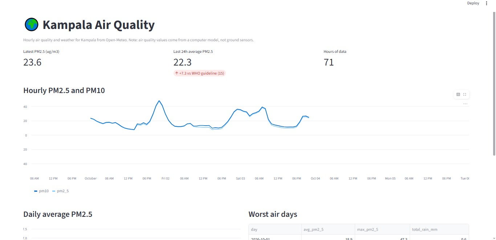
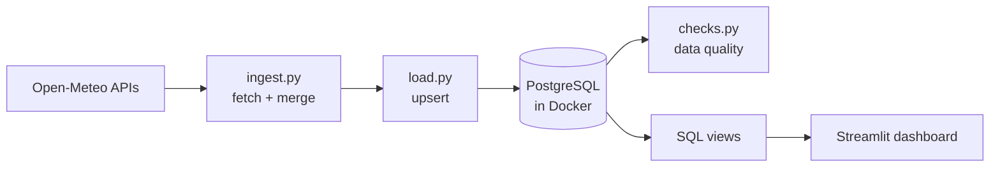

# Kampala Air Quality Pipeline

A small data pipeline that collects hourly air quality and weather data for Kampala, stores it in PostgreSQL, checks its quality, and shows it on a dashboard.




## Why I built this

I built this project to show how data engineering can turn raw data into something people can actually use: automatic collection, reliable storage, quality checks, and a clear dashboard. I used Kampala air quality as the example. The one limit on its real-world impact is that the data comes from a computer model, not ground sensors, so it shows general patterns rather than exact local readings.

## How it works



1. **Ingest:** pulls hourly PM2.5, PM10, NO2, ozone, temperature, humidity and rain for Kampala, and joins them into one table.
2. **Load:** writes the rows into PostgreSQL. It is safe to re-run: existing hours are updated, not duplicated.
3. **Check:** four data quality checks (freshness, missing hours, null share, value ranges). The script exits with an error if any fail.
4. **Analyse:** SQL views give daily averages, weekly averages, and the worst air days.
5. **Show:** a Streamlit dashboard reads from the views.

## Design decisions

- **Idempotent loads.** The table's primary key is the hour, and loads use `INSERT ... ON CONFLICT DO UPDATE`. Running the pipeline twice gives the same result as running it once.
- **Forecast vs real data.** The API returns predicted hours for the rest of today. Each row has an `is_forecast` flag, and all views and checks ignore forecast rows so averages are not quietly wrong. Forecast rows are overwritten with real values on later runs.
- **Partial days are excluded from rankings.** `worst_air_days` only counts days with all 24 hours.
- **Checks fail loudly.** A bad run should be noticed, not silently stored.

## Data source and limits

Data comes from [Open-Meteo](https://open-meteo.com/) (no API key needed). The air quality values come from a computer model, **not from ground sensors in Kampala**, so they show general patterns but are not exact local measurements.

## Run it locally

Requirements: Python 3.11+, Docker Desktop.

```bash
pip install -r requirements.txt
docker compose up -d                      # starts PostgreSQL
docker exec -i airquality-db psql -U pipeline -d airquality < sql/views.sql
python src/load.py                        # fetch + load
python src/checks.py                      # data quality checks
streamlit run dashboard/app.py            # dashboard
```

The `docker exec ... < sql/views.sql` line works in Command Prompt and bash.

## Project structure

```
├── src/
│   ├── ingest.py      # fetch and merge API data
│   ├── load.py        # upsert into PostgreSQL
│   └── checks.py      # data quality checks
├── sql/
│   ├── schema.sql     # table definition (runs on first start)
│   └── views.sql      # daily, weekly, worst-days views
├── dashboard/app.py   # Streamlit dashboard
├── docker-compose.yml
└── requirements.txt
```

## Status

- [x] Ingest and load (with upsert)
- [x] Data quality checks
- [x] SQL views
- [x] Streamlit dashboard
- [ ] Longer history (backfill)
- [ ] Scheduled daily runs (GitHub Actions)
- [ ] Cloud-hosted database
- [ ] Power BI report

## Author

Andrina Watsemba, Data Science & Analytics undergraduate.
[GitHub](https://github.com/andrinawatsemba) · [LinkedIn: https://www.linkedin.com/in/andrina-watsemba-2230bb266?utm_source=share_via&utm_content=profile&utm_medium=member_android]